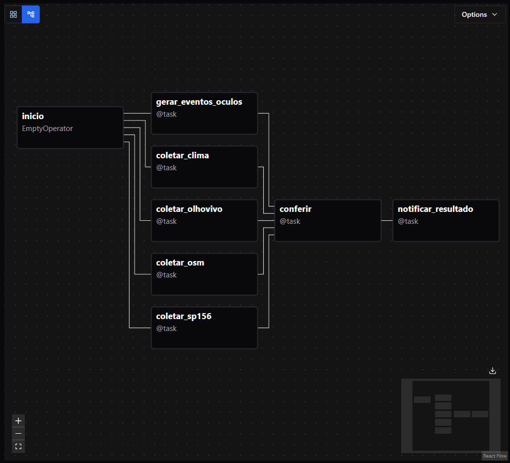
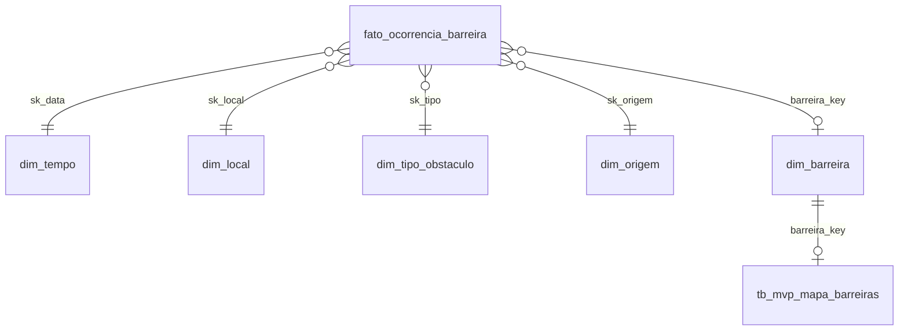
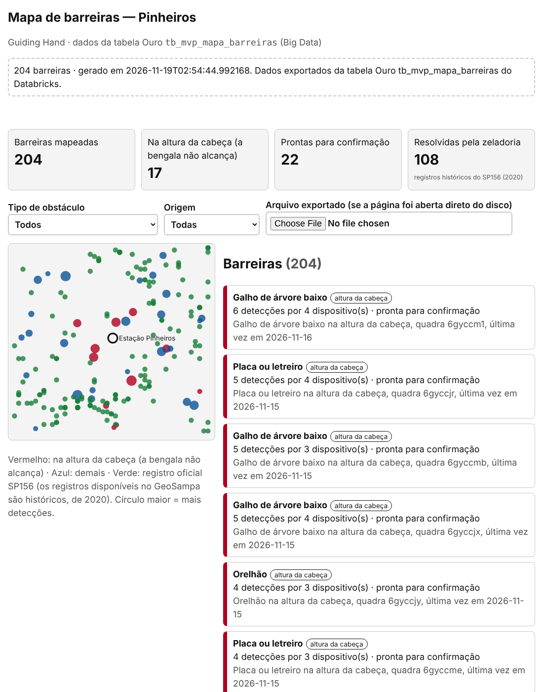

# Guiding Hand — Big Data Architecture & Data Integration

**FIAP · Global Solution 2026 · Engenharia de Software (4º ano) · Turma 4ESPV**

Pipeline de dados do **Guiding Hand**, uma solução de acessibilidade para pessoas cegas ou com baixa visão.
Ele coleta dados urbanos e ambientais com o **Apache Airflow 3** e organiza tudo num lakehouse **Bronze → Prata →
Ouro** no **Databricks Free Edition**. O resultado é um **mapa de barreiras** da região da Estação Pinheiros
(São Paulo – SP), consumido pela tela do MVP.

Repositório: https://github.com/juamori/Guiding-hand-big-data

| Integrante | RM | Turma |
|---|---|---|
| João Rodrigo Solano Nogueira | RM 551319 | 4ESPV |
| Julia Amorim Bezerra | RM 99609 | 4ESPV |
| Lana Giulia Auada Leite | RM 551143 | 4ESPV |
| Tony Willian da Silva Segalin | RM 550667 | 4ESPV |

> **Sobre as afirmações deste README.** Tudo o que aparece como resultado foi executado e tem print ou arquivo de
> evidência no repositório. O que não foi executado aparece como **pendente**. Os eventos dos óculos são
> **sintéticos** e estão identificados assim em todo o pipeline. Revisão completa, com checklists e riscos:
> [`docs/revisao_final.md`](docs/revisao_final.md).

---

## Sumário

1. [Problema e objetivo](#1-problema-e-objetivo)
2. [Escopo e região piloto](#2-escopo-e-região-piloto)
3. [Arquitetura](#3-arquitetura)
4. [Fontes de dados](#4-fontes-de-dados)
5. [Tecnologias](#5-tecnologias)
6. [Orquestração com Airflow](#6-orquestração-com-airflow)
7. [Bronze](#7-bronze)
8. [Prata](#8-prata)
9. [Ouro e modelo de dados](#9-ouro-e-modelo-de-dados)
10. [Consultas SQL do MVP](#10-consultas-sql-do-mvp)
11. [MVP](#11-mvp)
12. [Qualidade e testes](#12-qualidade-e-testes)
13. [LGPD e privacidade](#13-lgpd-e-privacidade)
14. [Como executar](#14-como-executar)
15. [Evidências](#15-evidências)
16. [Estrutura do repositório](#16-estrutura-do-repositório)
17. [Limitações e próximos passos](#17-limitações-e-próximos-passos)
18. [Conclusão](#18-conclusão)

---

## 1. Problema e objetivo

A bengala longa não detecta obstáculos **acima da cintura**: placas, galhos baixos, orelhões. Nas calçadas há
barreiras recorrentes (buracos, entulho, calçada quebrada) que não ficam registradas num lugar só. O Guiding Hand
propõe óculos inteligentes que avisam por voz e vibração. Cada obstáculo detectado alimenta um mapa de barreiras.

**Objetivo geral:** construir um pipeline de dados reprodutível que colete, organize e modele dados de barreiras
urbanas e entregue uma tabela analítica consumida pelo MVP.

**Objetivos específicos:**
- coletar diariamente fontes públicas reais e eventos dos óculos;
- ingerir de forma incremental e sem duplicação;
- validar e padronizar com regras de qualidade;
- modelar em esquema estrela;
- responder às perguntas do MVP com SQL;
- proteger dados ligados ao usuário.

## 2. Escopo e região piloto

| Item | Definição |
|---|---|
| Região | Retângulo de ~800 m em torno da Estação Pinheiros: lat -23,5750 a -23,5600; lon -46,7100 a -46,6940 (Variable `gh_bbox`) |
| Granularidade | Prata: coordenadas com 4 casas (~11 m). Ouro: célula geohash 7 (~150 m). Clima por hora |
| Periodicidade | Coleta diária às 07:00. A coleta do dia D traz o dia D-1 completo (clima e eventos) |
| Fora do escopo | Visão computacional real, app móvel em produção, backend público |

## 3. Arquitetura

```mermaid
flowchart LR
  subgraph Fontes
    A1[Open-Meteo]
    A2[OSM / Overpass]
    A3[SP156 / GeoSampa WFS]
    A4[Olho Vivo - sem token]
    A5[Eventos dos óculos - SINTÉTICOS]
  end
  subgraph Airflow 3 · diário 07:00
    I((inicio)) --> C1[coletar_clima] & C2[coletar_osm] & C3[coletar_sp156] & C4[coletar_olhovivo] & C5[gerar_eventos_oculos]
    C1 & C2 & C3 & C4 & C5 --> K[conferir] --> N[notificar_resultado]
  end
  K --> P[(chegada/)]
  P -- upload manual por lote --> V[(Volume chegada)]
  V -- Auto Loader --> B[Bronze]
  B -- schema + 7 regras + MERGE --> S[Prata + quarentena]
  S -- esquema estrela --> O[Ouro: fato + 5 dimensões]
  O --> M[tb_mvp_mapa_barreiras] -- JSON --> T[Tela do MVP]
```

O Databricks Free Edition não se conecta ao Airflow. Por isso, os arquivos da pasta `chegada/` vão para o Volume do
Databricks **manualmente, em lotes**. Justificativa de cada decisão técnica: [`docs/arquitetura.md`](docs/arquitetura.md).

## 4. Fontes de dados

| Fonte | Tipo | O que fornece | Formato | Coleta de 15/11 (lote 1) |
|---|---|---|---|---|
| **Open-Meteo** (Forecast API) | Real, sem chave | Clima horário: temperatura, chuva, rajadas, visibilidade | JSON | 24 horas |
| **OpenStreetMap / Overpass** | Real (ODbL) | Postes, árvores, lixeiras, travessias, piso tátil, pontos de ônibus | JSON | 573 elementos |
| **SP156 / GeoSampa** (WFS paginado) | Real, pública | Solicitações de zeladoria: serviço, situação, abertura, parecer | GeoJSON | 173 solicitações em 7 camadas |
| **Eventos dos óculos** | **Sintética** (`sintetico_v1`) | Detecções simuladas: tipo, posição, confiança, dispositivo | JSON | 67 eventos |
| **SPTrans Olho Vivo** | Real, exige token | Paradas de ônibus | JSON | **Não coletado** (sem token) |

Verificação da coleta real: [`docs/evidencias/coleta_2026-11-15.md`](docs/evidencias/coleta_2026-11-15.md) (resultado
**APROVADA**). Validação das fontes: [`docs/validacao_fontes/`](docs/validacao_fontes/).

Limitações das fontes:
- **SP156 histórico:** as solicitações disponíveis no GeoSampa vão de **abril a outubro de 2020**. Elas mostram onde a
  zeladoria registrou barreiras, não a situação atual das calçadas.
- **Clima regional:** a Open-Meteo responde com o centro da célula da grade do modelo, a 4,75 km do centro do recorte.
- **Eventos sintéticos:** o protótipo físico ainda não gera dados de campo. O gerador simula 45 obstáculos fixos e
  8 dispositivos. Ele inclui de propósito ruído de GPS, falsos alarmes, reenvios e registros inválidos, para testar a
  Prata. Todo registro sai marcado com `origem = sintetico_v1`.

Detalhes: [`docs/fontes.md`](docs/fontes.md) e [`docs/contrato_de_dados.md`](docs/contrato_de_dados.md).

## 5. Tecnologias

| Tecnologia | Uso |
|---|---|
| Python 3.12 | Coletores, gerador sintético, scripts e testes |
| Apache Airflow 3.0.6 | DAG com TaskFlow (`airflow.sdk`), Variables, retries e callback de falha |
| PostgreSQL + LocalExecutor | Metadados do Airflow |
| GitHub Codespaces | Ambiente de execução do Airflow (Docker Compose mantido como alternativa) |
| Databricks Free Edition (serverless) | Notebooks Bronze, Prata, Ouro, consultas e exportação |
| Unity Catalog + Volumes | `workspace.guiding_hand`; Volumes `chegada`, `controle` e `exportacao` |
| Auto Loader (`cloudFiles`) | Ingestão incremental da Bronze com checkpoint |
| Delta Lake | Tabelas, `MERGE INTO` e `DESCRIBE HISTORY` |
| PySpark 4 e Spark SQL | Transformações e modelo dimensional |
| pytest | Testes automatizados |
| HTML + JavaScript | Tela do MVP |

COPY INTO e MongoDB não são usados.

## 6. Orquestração com Airflow

DAG `guiding_hand_coleta` ([`dags/guiding_hand_coleta.py`](dags/guiding_hand_coleta.py)):

| Item | Implementação |
|---|---|
| Agendamento | `0 7 * * *` (America/Sao_Paulo), `catchup=False`, `max_active_runs=1` |
| Fluxo | `inicio` → **5 coletas em paralelo** → `conferir` → `notificar_resultado` |
| Saída | `chegada/<fonte>/<fonte>_<AAAA-MM-DD>.json` |
| Conferência | Presença, tamanho e estrutura de cada arquivo. Falha se faltar fonte obrigatória (clima, OSM, eventos) |
| Fontes opcionais | SP156 e Olho Vivo: sem configuração, a tarefa é pulada e o arquivo antigo do dia vai para `_descartados/` |
| Falhas | `retries=2` (intervalo de 2 min), timeout de 10 min, `on_failure_callback` com notificação; segredos mascarados nas mensagens |
| Parâmetros | Variables `gh_bbox`, `gh_pasta_chegada`, `gh_pasta_logs`, `gh_sp156_camadas`, `gh_overpass_urls`, `gh_olhovivo_termos` e, opcionalmente, `gh_olhovivo_token` |

**Execução real:**
- três execuções: 15/11 às 07:00, 15/11 às 07:14 (manual) e 16/11 às 07:00;
- **0 tarefas com falha** e **0 execuções com falha**;
- o Olho Vivo foi pulado nas três (sem token).



## 7. Bronze

Notebook usado: [`databricks/bronze/bronze_lote_1.py`](databricks/bronze/bronze_lote_1.py), com o widget `lote`
(1 ou 2). A tabela de destino é `workspace.guiding_hand.bronze_arquivos`.

- **Auto Loader:** `cloudFiles.format = text`, `wholetext = true` (uma linha por arquivo) e `trigger(availableNow=True)`.
- **Dados brutos preservados:** `conteudo_bruto` guarda o texto completo do arquivo.
- **Metadados por arquivo:**
  - origem: `arquivo_origem` e `nome_arquivo`;
  - classificação: `fonte` e `data_coleta`;
  - conteúdo: `tamanho_bytes` (bytes reais do arquivo) e `hash_conteudo` (SHA-256);
  - ingestão: `carregado_em`.
- **Sem duplicação:** o checkpoint no Volume `controle` impede reler um arquivo já processado. Além disso, um
  arquivo com o mesmo nome e o mesmo SHA-256 nunca é gravado duas vezes.
- **Controle:** `controle_execucoes_bronze` registra as contagens antes e depois de cada execução.

| Execução | Antes | Depois | Arquivos novos |
|---|---|---|---|
| lote 1 — 1ª execução | 0 | 4 | 4 |
| lote 1 — reexecução | 4 | 4 | **0** |
| lote 1 — reexecução | 4 | 4 | **0** |
| lote 2 — 1ª execução | 4 | 8 | 4 |

As consultas de duplicidade (mesmo caminho, e mesmo nome com o mesmo conteúdo) retornaram **0 linhas**.

O notebook [`01_bronze_autoloader.py`](databricks/bronze/01_bronze_autoloader.py), usado pelo orquestrador
`00_processar_lote`, tem a mesma lógica, mas os lotes deste trabalho foram processados pelo `bronze_lote_1`.

## 8. Prata

Notebook [`databricks/prata/02_prata.py`](databricks/prata/02_prata.py). Transformações em
[`databricks/lib/gh_transform.py`](databricks/lib/gh_transform.py).

| Etapa | O que é feito |
|---|---|
| Tipagem | Schema explícito por fonte (`from_json`); datas em vários formatos, incluindo o do GeoServer |
| Normalização | Tipos em minúsculas e sem espaços; status do SP156 → aberta, resolvida, cancelada ou desconhecido |
| Nulos | Precipitação nula → 0; origem nula → `desconhecida` |
| Inválidos | 7 regras; o registro barrado vai para `prata_quarentena` com a regra violada |
| Deduplicação | Versão mais recente por chave antes do MERGE (reenvios de `event_id` removidos) |
| MERGE | `MERGE INTO` por chave; só atualiza se o hash do registro mudou |
| SP156 | Campos reais mapeados em `mapeamento_sp156.json`. O protocolo (`cd_identificador`) foi escolhido pelo perfil dos dados reais ([`perfil_sp156_2026-11-15.md`](docs/evidencias/perfil_sp156_2026-11-15.md)) |

**Resultado do lote 1:**

| Tabela | Chave | Linhas |
|---|---|---|
| `prata_eventos_oculos` | `event_id` | 59 |
| `prata_clima_horario` | `data_hora` | 24 |
| `prata_osm_infraestrutura` | `osm_key` | 569 |
| `prata_sp156_solicitacoes` | `protocolo` | 168 |
| `prata_olhovivo_paradas` | `codigo_parada` | 0 |
| `prata_quarentena` | `fonte` + `chave_registro` + `regra` | 15 |

**Regras de qualidade e barrados:**

| Regra | Critério | Barrados |
|---|---|---|
| RQ1_CAMPOS_OBRIGATORIOS | chave, data/hora e coordenadas presentes | 0 |
| RQ2_FORA_DO_RECORTE | ponto dentro do retângulo de Pinheiros | **10** (eventos 1, OSM 4, SP156 5) |
| RQ3_TIPO_FORA_DO_DOMINIO | tipo conhecido pelo produto | **2** |
| RQ4_CONFIANCA_INVALIDA | 0 ≤ confiança ≤ 1 | **1** |
| RQ5_CONFIANCA_ABAIXO_DO_LIMIAR | confiança ≥ 0,5 | **2** |
| RQ6_MEDIDA_FISICA_IMPOSSIVEL | precipitação e visibilidade ≥ 0; temperatura entre -10 e 50 °C | 0 |
| RQ7_DATAS_INCOERENTES | conclusão ≥ abertura | 0 |

**Os números fecham com a coleta:**
- OSM: 569 + 4 = 573 elementos;
- SP156: 168 + 5 = 173 solicitações;
- clima: 24 de 24 horas.

Detalhes: [`docs/regras_qualidade.md`](docs/regras_qualidade.md).

## 9. Ouro e modelo de dados

Notebook [`databricks/ouro/03_ouro.py`](databricks/ouro/03_ouro.py); SQL em [`databricks/lib/ouro_sql.py`](databricks/lib/ouro_sql.py).



| Tabela | Papel | Linhas (lote 1) |
|---|---|---|
| `fato_ocorrencia_barreira` | Uma ocorrência de barreira: detecção dos óculos, solicitação SP156 ou elemento OSM que é obstáculo | 300 |
| `dim_tempo` | Data, mês, dia da semana, fim de semana | 114 |
| `dim_local` | Centro da célula geohash 7 (~150 m) | — |
| `dim_tipo_obstaculo` | Descrição, altura, se a bengala costuma detectar | — |
| `dim_origem` | oculos_sintetico, sp156, osm | — |
| `dim_barreira` | Barreira única: células do mesmo tipo a até 20 m são unificadas (ruído de GPS) | 194 |
| `tb_mvp_mapa_barreiras` | Tabela consumida pelo MVP, **sem dado de dispositivo** | 194 |

Detalhes: [`docs/modelo_dimensional.md`](docs/modelo_dimensional.md).

## 10. Consultas SQL do MVP

Arquivo [`databricks/sql/consultas_mvp.sql`](databricks/sql/consultas_mvp.sql), executado pelo notebook
[`04_consultas_mvp`](databricks/ouro/04_consultas_mvp.py). São seis consultas; a **C5 mede o impacto**.

| ID | Pergunta | Resultado (lote 1) |
|---|---|---|
| C1 | Quais tipos de obstáculo são mais recorrentes, e quantos a bengala não detecta? | Buraco (SP156) lidera, com 149 ocorrências. Galho, placa e orelhão são os tipos invisíveis à bengala |
| C2 | Quais quadras (~150 m) concentram mais barreiras? | A célula `6gyccht` lidera, com 9 barreiras distintas |
| C3 | Quais barreiras aparecem em mais de uma coleta? | Vazia com um só dia na Ouro. Depende da Ouro com os dois lotes |
| C4 | Como a chuva se relaciona com as detecções? | Sem chuva: 2,8 detecções/h. Com chuva: 4,6 detecções/h (ver ressalva) |
| C5 | **Impacto:** barreiras mapeadas, invisíveis à bengala, prontas para confirmação e resolvidas | 194 mapeadas. 13 invisíveis à bengala (6 SP156 + 7 óculos). 6 prontas para confirmação. 108 resolvidas pela zeladoria |
| C6 | Como evolui, dia a dia, o número de barreiras identificadas e resolvidas? | 101 dias com movimento (inclui o histórico de 2020 do SP156) |

**Conferências:**
- a soma da C1 é igual ao total do fato (300);
- 168 (SP156) + 26 (óculos) = 194 = `dim_barreira`.

**Ressalvas:**
- A **C4** cruza clima real com detecções sintéticas, e o gerador não usa o clima. Ela demonstra a integração das
  fontes, não um efeito da chuva.
- Na **C5** e na **C6**, o SP156 é histórico (2020) e os óculos são sintéticos (2026). Leia os números por origem.

## 11. MVP

A tela [`mvp_demo/index.html`](mvp_demo/index.html) lê o `barreiras_mvp.json` exportado da `tb_mvp_mapa_barreiras`
pelo notebook [`05_exportar_mvp`](databricks/mvp/05_exportar_mvp.py). A tela gerada em 18/11 mostra:
- **194 barreiras mapeadas**;
- **13 na altura da cabeça**;
- **6 prontas para confirmação**;
- **108 resolvidas pela zeladoria**.

Os números são os mesmos da C5. Filtros: tipo de obstáculo e origem. As solicitações do SP156 com mais de um ano
aparecem marcadas como **registro histórico (2020)**.



## 12. Qualidade e testes

**Qualidade no pipeline:**
- conferência das coletas no Airflow;
- verificação do conteúdo da coleta (`scripts/verificar_chegada.py`);
- 7 regras com quarentena;
- deduplicação e MERGE idempotente;
- integridade da Bronze por SHA-256 e bytes;
- recusa de dados de simulador na escolha do protocolo SP156.

**Testes automatizados** (pytest, executados fora do Databricks):

| Ambiente | Resultado |
|---|---|
| Codespace (Python 3.12 + Airflow 3.0.6, sem PySpark) | **68 passaram**, 6 pulados (os testes de Spark) |
| Python 3.13 + PySpark 4.0.1 + Java 21 | **94 passaram**, 1 pulado (o do DAG, sem Airflow) |
| Airflow 3.0.6 (`tests/test_dag.py`) | **3 passaram** |

Os testes cobrem coletores, paginação, máscara de segredos, gerador sintético, conferência, DAG, Bronze
(checkpoint, bytes, continuidade entre lotes), Prata, Ouro, SQL, perfil do SP156, lotes, segredos e relatório.

## 13. LGPD e privacidade

**Medidas implementadas** ([`docs/lgpd.md`](docs/lgpd.md)):
- nenhuma imagem é recebida ou armazenada; o contrato prevê só tipo, posição e confiança;
- `device_hash = SHA-256(device_id + salt)` na Prata, com o `device_id` original descartado; o salt fica fora do Git
  (secret scope ou arquivo no Volume `controle`);
- localização generalizada: ~11 m na Prata, ~150 m na Ouro, e o mapa mostra o centro do agrupamento;
- `tb_mvp_mapa_barreiras` não tem nenhuma coluna de dispositivo (garantido por teste);
- chaves só em Variables do Airflow; `scripts/verificar_segredos.py` roda antes de cada publicação.

**Não há declaração de conformidade completa com a LGPD.** Os dados dos óculos são sintéticos. Com dados reais
seriam necessários:
- base legal e consentimento;
- relatório de impacto (RIPD);
- política de retenção;
- acesso restrito à Bronze, que guarda a coordenada exata;
- cofre de segredos para o salt.

## 14. Como executar

**Airflow (GitHub Codespaces):** abra um Codespace do repositório. O `.devcontainer/` instala o PostgreSQL e o
Airflow 3.0.6. No terminal, rode `bash scripts/codespaces/menu.sh`. Guia: [`docs/codespaces.md`](docs/codespaces.md).

| Menu | Ação |
|---|---|
| **0** | Verifica o ambiente |
| **1** | Valida as fontes reais |
| **2** | Inicia o Airflow |
| **3** | Executa a coleta e verifica o conteúdo |
| **4** | Prepara o lote para o Databricks |
| **5** | Testes automatizados |
| **6** | Verifica segredos |
| **7** | Abre a tela do MVP |
| **8** | Gera o relatório PDF |
| **G** | Publica no GitHub |
| **9** | Para o Airflow |
| **S** | Sai do menu |

No Windows com Docker, a alternativa é o `GuidingHand.bat` ([`docs/passo_a_passo.md`](docs/passo_a_passo.md)).

**Databricks Free Edition:**
1. Execute `databricks/00_setup.sql` (schema e Volumes).
2. Envie os `.json` do lote para o Volume `chegada`.
3. Rode `bronze/bronze_lote_1.py` com `lote = N`, **duas vezes**. A segunda execução deve trazer 0 arquivos novos.
4. Rode `prata/02_prata`, `ouro/03_ouro`, `ouro/04_consultas_mvp` e `mvp/05_exportar_mvp`.
5. Baixe `barreiras_mvp.json` do Volume `exportacao` para `mvp_demo/data/` e abra a tela (menu 7).

Os notebooks importam `../lib`, então o repositório deve estar no Databricks como **Git folder**. Em outra estrutura
de pastas, ajuste o caminho no workspace, sem levar caminhos pessoais para o Git.

**Linha de comando:**

```bash
pip install -r requirements-dev.txt
pytest -q tests                    # testes Spark exigem Java 17+
python scripts/pipeline_local.py   # Bronze → Ouro local com dados de teste
```

## 15. Evidências

| Evidência | Arquivo |
|---|---|
| Airflow: Graph, execuções de 15 e 16/11, Variables | `docs/relatorio/prints/01_airflow_graph.png`, `02_airflow_grid.png`, `03_airflow_variables.png` |
| Validação das fontes e verificação da coleta real | `docs/validacao_fontes/`, `docs/evidencias/coleta_2026-11-15.md` |
| Perfil do SP156 (escolha do protocolo) | `docs/evidencias/perfil_sp156_2026-11-15.md` |
| Lotes preparados | `docs/lotes/lote_1.md`, `docs/lotes/lote_2.md` |
| Volume com o lote 1 | `docs/relatorio/prints/05_upload_lote1.png` |
| Bronze: contagens dos lotes 1 e 2 | `docs/relatorio/prints/07_bronze_contagens.png` |
| Bronze: reexecução e duplicidade | `docs/evidencias/prints_databricks_lote1/02_*.png` e `03_*.png` |
| Prata: MERGE e quarentena por regra | `docs/evidencias/prints_databricks_lote1/06_*.png`, `docs/relatorio/prints/08_prata_quarentena.png` |
| Ouro: tabelas | `docs/relatorio/prints/09_ouro_tabelas.png` |
| Consultas C1 a C6 | `docs/evidencias/prints_databricks_lote1/09_*.png` a `14_*.png` |
| Tela do MVP | `docs/relatorio/prints/10_tela_mvp.png` |
| Testes no Codespace | `docs/evidencias/prints_airflow_lote2_mvp/03_testes_codespace_68_passed.png` |

Transcrição dos números observados: [`docs/evidencias/databricks_lote_1.md`](docs/evidencias/databricks_lote_1.md) e
[`docs/evidencias/airflow_lote2_mvp.md`](docs/evidencias/airflow_lote2_mvp.md). Nos prints do Databricks, o caminho
da pasta pessoal do workspace foi ocultado.

**Pendentes:** print do Volume com o lote 2 e resultados da Prata, da Ouro e das consultas depois do lote 2.

## 16. Estrutura do repositório

```
dags/                       DAG do Airflow e biblioteca de coleta (coletores, conferência, gerador sintético)
airflow/                    modelo das Variables (sem chaves)
databricks/00_setup.sql     schema e Volumes
databricks/bronze/          bronze_lote_1.py (usado nos lotes) e 01_bronze_autoloader.py (orquestrador)
databricks/prata/           02_prata.py
databricks/ouro/            03_ouro.py e 04_consultas_mvp.py
databricks/mvp/             05_exportar_mvp.py e 06_exportar_evidencias.py
databricks/lib/             transformações, SQL da Ouro e mapeamento do SP156
databricks/sql/             consultas_mvp.sql e contagens_bronze.sql
mvp_demo/                   tela do MVP
scripts/                    validação, verificação da coleta, perfil SP156, lotes, segredos, relatório, Codespaces
tests/                      testes automatizados
docs/                       arquitetura, fontes, contrato, qualidade, LGPD, modelo, evidências, revisão final
```

## 17. Limitações e próximos passos

- **Eventos dos óculos sintéticos:** as análises de detecção (C3, C4 e parte da C5) demonstram o pipeline, não o
  comportamento real das ruas.
- **SP156 histórico (2020):** a tela marca cada solicitação com mais de um ano como "registro histórico (2020)",
  mas a tabela Ouro ainda não tem uma coluna própria para isso.
- **Olho Vivo** não utilizado (sem token).
- **Clima** com resolução regional (~4,75 km).
- **Resolução de entidade no driver:** adequada ao volume do protótipo. Em escala, trocar por clusterização
  distribuída (por exemplo, H3).
- **Integração com o MVP por arquivo JSON**, porque o Free Edition não oferece backend público.
- **Próximos passos:**
  - dados reais de campo dos óculos;
  - coluna de histórico do SP156 na tabela Ouro;
  - token do Olho Vivo;
  - publicação automática do JSON;
  - recorte configurável para outros bairros.

## 18. Conclusão

O pipeline foi implementado de ponta a ponta e executado com dados reais:
- **Coleta:** Airflow com coletas em 15 e 16/11, sem falhas.
- **Bronze:** dois lotes ingeridos pelo Auto Loader (0 → 4 → 8 arquivos), com reexecuções sem duplicação.
- **Prata:** 820 registros válidos e 15 barrados por 4 regras.
- **Ouro:** 300 ocorrências e 194 barreiras.
- **Consultas e MVP:** seis consultas SQL e uma tela com os mesmos números da consulta de impacto.

Os resultados se conferem entre si e com a coleta original. As limitações (eventos sintéticos, SP156 histórico)
estão declaradas, junto com o que seria necessário para usar dados reais.
