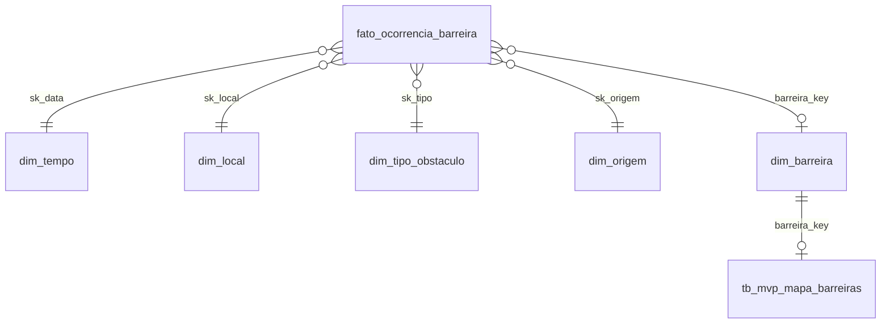

# Modelo dimensional da Ouro (Requisito 07)

**Grão do fato:** uma ocorrência de barreira — uma detecção válida dos óculos (exceto pessoas), uma solicitação SP156 de um serviço ligado a barreira, ou um elemento do OSM que é obstáculo (poste, lixeira, árvore).

| Tabela | Tipo | Chave | Conteúdo |
|---|---|---|---|
| fato_ocorrencia_barreira | fato | id_ocorrencia | data/hora, status, datas de identificação e resolução, dias até resolver, confiança, chuva na hora, device_hash |
| dim_tempo | dimensão | sk_data (AAAAMMDD) | data, mês, dia da semana, fim de semana |
| dim_local | dimensão | sk_local (geohash 7) | centro da quadra (~150 m) |
| dim_tipo_obstaculo | dimensão | sk_tipo | descrição, altura, se a bengala costuma detectar |
| dim_origem | dimensão | sk_origem | óculos (sintético), SP156, OSM |
| dim_barreira | dimensão | barreira_key | entidade resolvida: tipo, centro, número de células unificadas, protocolo oficial |
| tb_mvp_mapa_barreiras | consumo | barreira_id | o que a tela do MVP mostra (sem dado pessoal) |

## Chave de negócio e deduplicação

| Nível | Chave | Problema que resolve |
|---|---|---|
| Evento | `event_id` | Reenvio do mesmo evento pelo dispositivo (MERGE na Prata) |
| Célula | `sha256(tipo + geohash8)` | Agrupa detecções do mesmo tipo numa célula de ~38 × 19 m |
| Barreira | células do mesmo tipo com centros a ≤ 20 m são unificadas (união-busca na Ouro) | O ruído de GPS faz o mesmo obstáculo cair em células vizinhas. Nos testes isso inflava o mapa de ~33 para 56 barreiras; após a unificação, 34 |
| SP156 | `protocolo` | Cada solicitação oficial é uma barreira; a versão mais recente (status) vence no MERGE |

Limitação: dois obstáculos **do mesmo tipo** a menos de 20 m viram uma barreira só. Para o mapa de acessibilidade isso é aceitável, porque o alerta é o mesmo. Em escala, a unificação no driver deve ser trocada por clusterização espacial distribuída (ex.: H3 + DBSCAN).
